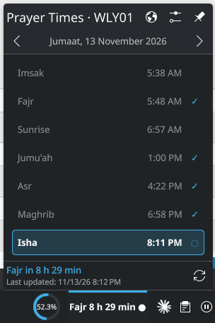
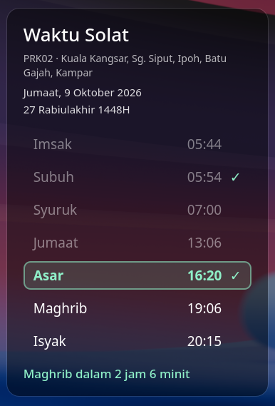
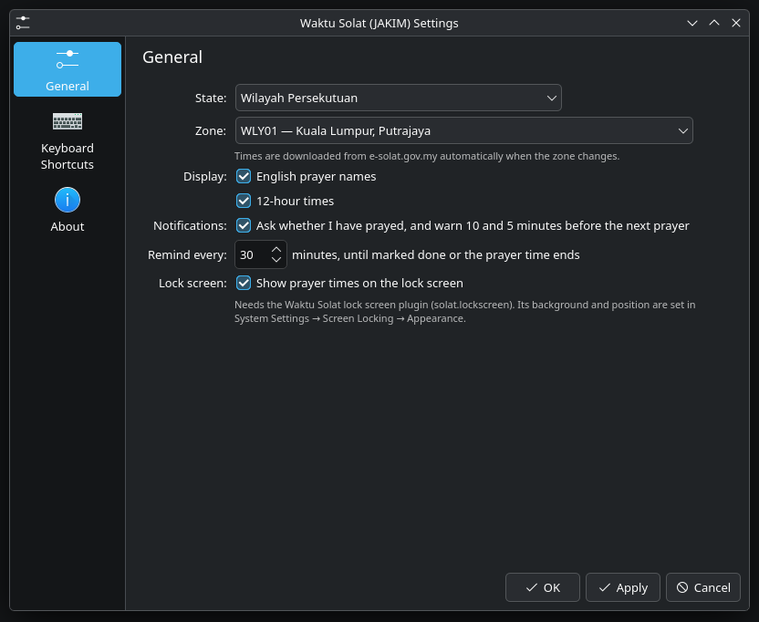

<p align="center"></p>

# kde-plasma-solat

Malaysian prayer times from [JAKIM e-solat](https://www.e-solat.gov.my) for KDE Plasma 6: a panel widget and a lock screen.

<p>
  
  
</p>

- **Panel widget** with the next prayer and a countdown; click for the full day, tick prayers off ✓, browse other days with the arrows, resync on demand, open e-solat, settings and a *keep open* pin
- All 60 JAKIM zones, Malay or English names, 24h or 12h
- Gregorian and Hijri dates
- Check marks reset at **Imsak**, not midnight (the day runs from Imsak to the next Imsak)
- Notifications ask "Sudah solat?" when each prayer time starts and remind you until you mark it done, with a heads-up 10 and 5 minutes before the next prayer time if it is still unticked
- Optional lock screen showing the same times and check marks, the last update time and a refresh button
- Works offline: about 60 days of times are cached and refreshed automatically

Nothing to run by hand: the widget downloads the times, keeps the check marks, sends the reminders and feeds the lock screen itself. Everything runs inside Plasma, so there is no background service and no separate program.

## Install

### Arch Linux

```sh
git clone https://github.com/qatoqat/kde-plasma-solat
cd kde-plasma-solat/packaging/arch
makepkg -si
```

### Any distro

You need Plasma 6 with `kpackagetool6` and `kwriteconfig6`; no compiling.

```sh
./install.sh      # installs for your user into ~/.local/share/plasma
./uninstall.sh    # undo
```

Or download `solat.widget.plasmoid` (and optionally `solat.lockscreen.plasmoid`) from the [releases](https://github.com/qatoqat/kde-plasma-solat/releases) and install them with `kpackagetool6 -t Plasma/Applet -i solat.widget.plasmoid` (use `-t Plasma/Wallpaper` for the lock screen one), or through *Get New Widgets → Install from file*.

## Use

1. Right-click a panel → **Add Widgets** → **Waktu Solat**.
2. Right-click the widget → **Configure** (or the gear in its popup) and pick your zone. The default is PRK02.



3. Optional: tick **Show prayer times on the lock screen** in the same dialog. Background image, dimming and position are set in System Settings → Screen Locking → Appearance.

Upgrading from the old `solat-lock` package: settings and today's check marks are imported on first start. The old `solat` command and systemd services are gone; `systemctl --user disable --now solat.timer solat.path solat-notify.service` removes the leftovers.

## How it works

- **`solat.widget`** (QML): downloads the timetable from e-solat (falling back to `curl` if Qt's own network stack stalls), stores it in the widget's config, tracks check marks per day, sends notifications through KDE's notification service and writes the data the lock screen needs into `kscreenlockerrc`.
- **`solat.lockscreen`** (QML): a Plasma wallpaper plugin. The lock screen is sandboxed with no network access, so it only shows what the widget saved. Tapping a prayer there ticks it, and the widget picks the change up within about 15 seconds. The refresh button there works the same way: it leaves a request for the widget, which does the download.

KWin doesn't support `ext-session-lock`, so this doesn't replace the KDE locker. KDE still does the locking and checks your password.

## Notes

- The widget has to be in a panel for downloads and reminders to run. If you add it to several panels you will get duplicate notifications.
- Tapping on the lock screen saves your check-off only if `kscreenlocker` is built without its seccomp sandbox, as Arch builds it. With the sandbox, the tick shows but isn't saved.
- Anyone at your locked computer can tick or untick the current day's prayers. They can't do anything else.

## Development

```sh
node widget/test-logic.mjs        # unit tests for the date/timetable logic
python3 widget/tests/run.py       # widget behaviour tests (needs qml6, no Plasma session)
scripts/smoke.sh                  # in a live Plasma session: restart the shell, fail if the widget does not load
python3 scripts/build.py     # builds dist/*.plasmoid
scripts/build-icons.sh       # re-renders icons/png from icons/kde-plasma-solat.svg (needs rsvg-convert)
```

The behaviour tests load the real `main.qml` against stub Plasma modules (`widget/tests/stubs`) with a controllable clock, and cover downloads, settings taking effect immediately, the Imsak day boundary, notifications, lock screen sync and first-run import. The headless tests do not run the views, so run `scripts/smoke.sh` in a Plasma session after changing them. Add a case to `widget/tests/tst_widget.qml` for every bug you fix.

Pushing a `v*` tag builds the `.plasmoid` files in CI and attaches them to the release.

## Changelog

See [CHANGELOG.md](CHANGELOG.md).

## License

GPL-2.0-or-later
